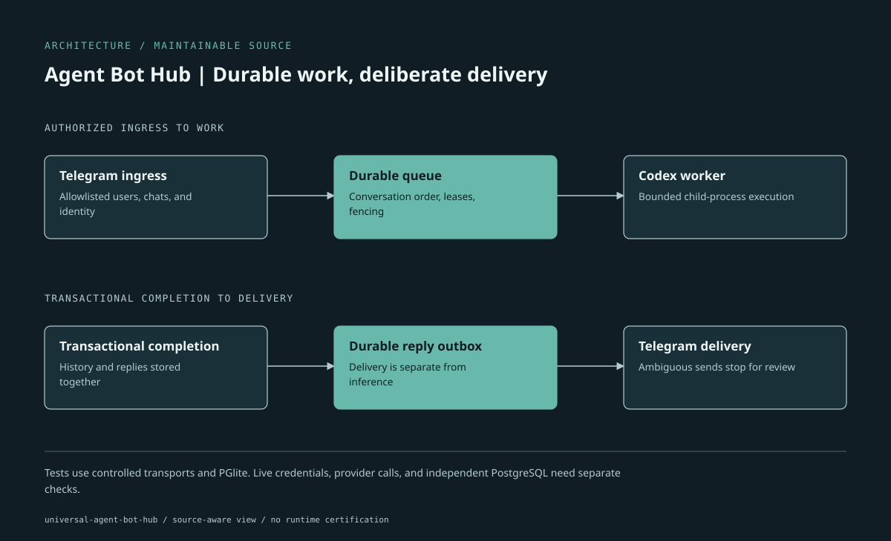

# Universal Agent Bot Hub

A Telegram-first Node.js agent gateway with durable PostgreSQL jobs and a Codex CLI worker. The repository also retains a small SQLite/mock prototype. This is not a generic hosted bot service: Telegram and Codex are the implemented live adapters; other channels and runtimes are design work, not available integrations.

[Telegram setup](docs/telegram.md) · [Development and checks](docs/development.md) · [Architecture](docs/architecture.md) · [Design documents](docs)

## Try it without credentials

Requires Node.js 24+ and npm:

```sh
git clone https://github.com/Guilsc/universal-agent-bot-hub.git
cd universal-agent-bot-hub
npm ci
npm test
npm run demo
```

The demo uses SQLite and the mock runtime, not Telegram, PostgreSQL, or a live model. Tests use PGlite and simulated transports; independent PostgreSQL connection tests run only when `TEST_DATABASE_URL` is set to a dedicated test database.

## Architecture



[Editable HTML/SVG source](docs/architecture.html) · [Diagram style](docs/assets/architecture.style.json)


The gateway authorizes incoming users/chats and persists updates. Workers claim leased jobs in conversation order; successful completion stores history and outgoing replies transactionally. Delivery is a separate loop. Ambiguous Telegram sends stop in `uncertain` state for operator review rather than blindly resending. See the [diagram and source map](docs/architecture.md).

## Run the Telegram flow

You need a dedicated PostgreSQL database, a Telegram bot token, your numeric user ID, the bot username from BotFather, and an authenticated Codex CLI. Follow [Telegram setup](docs/telegram.md) before starting:

```sh
# Configure .env from .env.example and keep real secrets outside Git.
npm run smoke:codex
npm start
```

`TELEGRAM_BOT_USERNAME` is required and checked against Telegram's `getMe`; no personal bot identity is assumed. Polling is the default. Webhook mode requires an HTTPS reverse proxy and separately registered webhook with a shared secret. `npm run gateway` and `npm run worker` can run separately.

## Project structure

| Path | Responsibility |
| --- | --- |
| `src/` | Gateway, durable routing, runtime adapters, worker and delivery loops |
| `migrations/` | PostgreSQL schema history |
| `test/` | Mock, PGlite, protocol and optional PostgreSQL checks |
| `docs/` | Architecture, Telegram setup, operations and design boundaries |
| `compose.yaml` | Development service configuration; not deployment authorization |
| `.github/workflows/` | Automated repository checks |

## Maintenance and distribution

Use a development branch and keep transport/runtime adapters behind their existing boundaries. Do not remove the mock demo or failure fixtures as junk: they allow verification without model calls or chat credentials. Run `npm ci`, `npm test`, and a production-dependency audit before review. The root npm package is private; source changes do not publish a package, activate a bot, or constitute a supported release. GitHub derives the Languages panel automatically.

## Operations and limits

- Allowlisted users are required; group chats require an explicit chat allowlist.
- Runner defaults: read-only sandbox, disabled web search, bounded history, and a two-minute attempt deadline. File writes and network access are opt-in; the Codex sandbox is not container isolation.
- `npm run status` reports queue counts and uncertain delivery IDs without printing message bodies. Use `npm run outbox:resolve -- UUID --mark-sent`, `--retry`, or `--discard` only after checking the corresponding chat.
- Runtime databases, worker files, authentication, tokens, and message history are private operational data. Configure retention, backups, secret rotation, resource limits, and process-tree isolation before deployment.
- Webhook `/healthz` checks database reachability, not model availability or end-to-end delivery. Polling mode opens no HTTP listener.

Production deployment and live Telegram/Codex exchanges are not established by the local tests. No license is declared in this repository; do not assume permission to redistribute it under an invented license.

## License

The source is licensed under the [MIT License](LICENSE).
