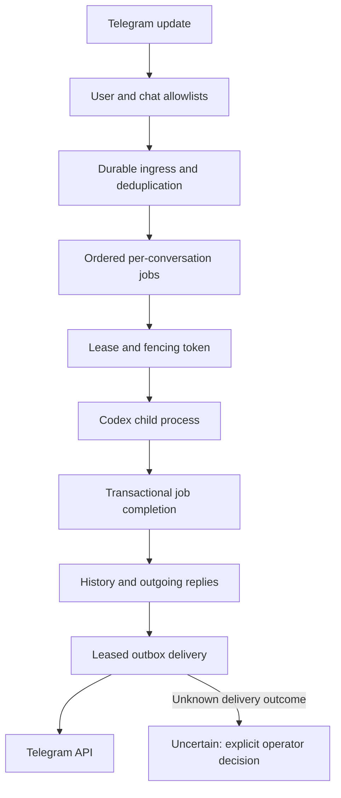

# Architecture

The implemented flow connects Telegram to a durable PostgreSQL work queue and a Codex CLI adapter. This is not a claim of production availability or support for additional live transports.

## Source ownership

| File | Boundary |
| --- | --- |
| `src/config.js` | Explicit bot identity, secret-file inputs, allowlists and validated runtime settings |
| `src/start.js`, `src/gateway.js` | Startup, polling and durable ingress |
| `src/webhook.js` | Authenticated HTTP ingress when explicitly configured |
| `src/telegram.js`, `src/bot-commands.js` | Transport behavior, authorization and conversation commands |
| `src/postgres.js`, `migrations/` | Persistence, transactions, leases and fencing |
| `src/worker.js`, `src/run-worker.js` | Work claims, lease renewal and completion |
| `src/codex-runner.js`, `src/codex-executable.js` | Child-process execution, bounded inputs, timeout and executable discovery |
| `src/status.js`, `src/resolve-outbox.js` | Restricted operator visibility and ambiguous-delivery resolution |
| `src/hub.js`, `src/demo.js` | Retained local SQLite/mock prototype |

## Reliability boundaries

Duplicate ingress must not create duplicate work. Conversation ordering and fenced leases prevent a stale worker from completing a job after ownership changes. Successful history and outgoing replies are stored together; sending occurs outside that transaction.

A reply whose send outcome is ambiguous is not automatically resent: it enters `uncertain` for operator review. Configured rate-limit/backoff handling is distinct from retrying an unknown send. Review retention, backups, database privileges, process isolation and resource limits before operating the service.

`TELEGRAM_BOT_USERNAME` must be supplied and is used consistently for routing. A model process is not an authority boundary by itself; read-only sandbox defaults are not a replacement for operating-system isolation.

## Verification scope

`npm test` uses controlled transports, temporary runtime processes and PGlite. Tests requiring independent PostgreSQL connections are skipped unless a dedicated `TEST_DATABASE_URL` is configured. The mock demo does not contact a model or Telegram. Live credential, inference and delivery tests are separate authorized operations.
